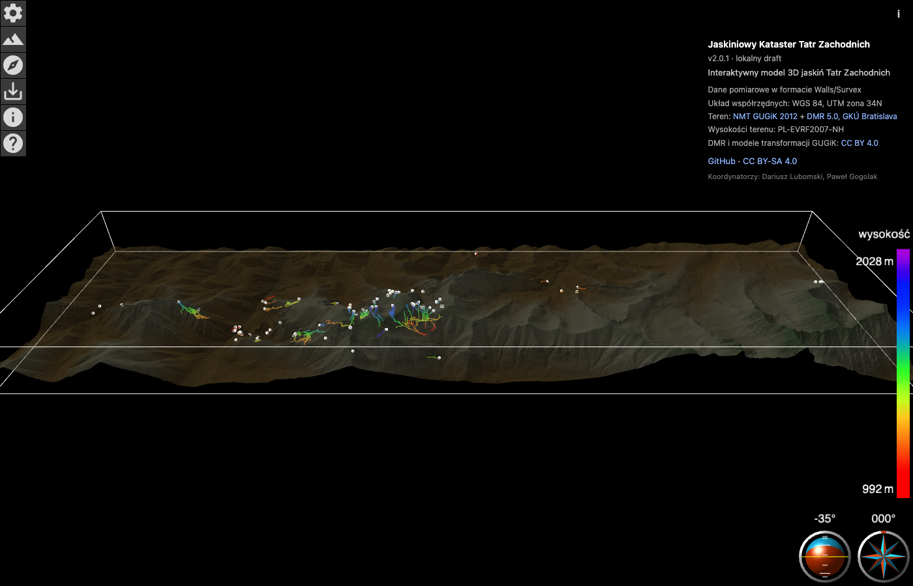

# Podgląd terenu pełnego KATASTER.3d

Draft z 2026-11-17: CaveView 2.9.0, niezmieniony KATASTER.3d v2.0.1,
NMT GUGiK ALS2012 + DMR 5.0 GKÚ Bratislava. Podgląd internetowy działa jako
osobna witryna; główny widok GitHub Pages nie został podmieniony.
Aktualny adres jest w opisie draft PR.

Wybrano jeden poziom z14, 65 kafli, divisions=128, krok około 12,47 m
w terenie, 2 163 330 B. Początkowy z13 miał krok 24,95 m i 698 922 B,
ale maksymalne odchylenie siatki od natywnego rastra w kontrolach wynosiło
20,75 m; z14 zmniejszył je do 13,28 m. Nie ma mieszania LOD.

## Zakres i pochodzenie

Po wczytaniu całego modelu viewer używa granic EPSG:3857:
`[2203899.117, 6312535.765, 2234426.659, 6321579.954]`.
Pełne kafle obejmują **19,797363–20,083008°E, 49,210420–49,282140°N**.
Audyt źródeł objął szerszy zakres początkowego z13 oraz margines interpolacji.

Polska: 53 arkusze NMT ALS2012 1 m, EPSG:2180, PL-KRON86-NH,
przekształcone oficjalną siatką GUGiK `H_EVRF2007 = H_KRON86 + dH`.
Słowacja: numeryczne wycinki WCS DMR 5.0 5 m, EPSG:25834,
wysokości elipsoidalne GRS80; `H = h − ζ(PL-geoid2021)`.
Źródła, adresy, licencje, SHA-256 i ograniczenia transformacji opisuje
[README zestawu](../../web/terrain/README.md) oraz
[manifest wejść](../../web/terrain/source-manifest.json).

PL ma pierwszeństwo, SK uzupełnia brak PL. Wszystkie cztery próbki interpolacji
muszą być poprawne. Nie wypełniano NoData ani nie dopasowywano do otworów.
`terrainDatumShift: false`. Model HGT odrzucono z powodu niepotwierdzonego datum Z.

## Kontrole

| Kontrola | Wynik |
|---|---|
| 18 541 stacji, w tym 11 na wschód od 20°E | 18 541 poprawnych próbek |
| Nová Kresanica / Občasná vyvieračka | 155/155 i 63/63 |
| Pokrycie większego obszaru na siatce 5 m | 8 561 727 centrów, zero braków |
| Wszystkie węzły z14 | 1 067 265, zero braków |
| 279 próbek rzeczywistych indeksowanych trójkątów WebGL | ≤0,000309 m względem zakodowanego DTM |
| 112 wspólnych krawędzi kafli | 0 m różnicy |
| Z wszystkich 18 554 odcinków po reprojekcji | dokładnie 0 m zmiany |
| Obrót myszą, zoom, przełączanie terenu, reload | PASS, wszystkie kafle z14 |
| Brak pojedynczego BIN / przywrócenie | brak terenu bez płaskiego zastępstwa / 65 kafli po reloadzie |

Tabela wszystkich XY i wysokości: [CSV](2026-11-17-terrain-heights.csv).
21 punktów ma referencję GNSS/sieci w znanym datum; część ma wspólne dowiązania,
więc nie są to 21 niezależne realizacje geodezyjne. Pozostałe punkty kontrolują
przetwarzanie rastra na mesh, również przy granicach arkuszy i w części słowackiej.

| Punkt | Pomiar H | Cesium h przed | Nowy mesh H | Nowy minus pomiar |
|---|---:|---:|---:|---:|
| Kozia, otwór I | 1836,99 | 1854,49 | 1841,01 | +4,02 |
| Kozia, otwór II | 1839,47 | 1834,86 | 1840,75 | +1,29 |
| Kozia I, punkt GNSS | 1833,45 | 1845,22 | 1833,78 | +0,33 |
| Kozia II, punkt GNSS | 1839,82 | 1836,24 | 1841,02 | +1,20 |

Metry. H oznacza PL-EVRF2007-NH; h Cesium jest wysokością elipsoidalną WGS84
i nie należy odejmować go od H. W obu punktach GNSS są również pomiary h:
1876,0467 i 1882,4167 m. Bezpośrednie błędy Cesium h minus GNSS h wynoszą
−30,82 i −46,17 m. CSV zawiera także pomocnicze `h−ζ` z PL-geoid2021;
to przybliżenie WGS84/ETRS89, nie zmiana wyświetlanego terenu ani pomiarów.

## Transfer i ograniczenia

Trzy świeże konteksty Chromium 157 / WebGL2 / Apple M4, 1400×900, DPR1,
ten sam pełny kadr, HTTP cache wyłączony, standardowy bundle:

| Miara | Cesium | Z14 |
|---|---:|---:|
| Mediana transferu kafli | 606 881 B | 2 163 330 B |
| Mediana całości z nagłówkami | 2 967 121 B | 4 533 642 B |
| FPS podczas obrotu | 59,70–60,23 | 59,99–60,19 |

CWT pobierano przez Internet, nowy teren z loopback bez kompresji HTTP.
Nie porównywano w ten sposób szybkości publicznych hostingów.

Pokrycie i działanie: **PASS**. Pełne niezależne potwierdzenie dokładności
wysokości: **INCOMPLETE** — brak odpowiednich kontroli na skrajnym zachodzie,
wschodzie i na Słowacji. Nie oszacowano różnic realizacji/epoki ETRS89 SK
względem PL-ETRF2000. Przy przejściu PL/SK źródła różnią się do 4,74 m;
to rozbieżność danych, nie szczeliny kafli. Największe odchylenie mesh–raster
w kontrolach: 13,28 m na stromym terenie. Safari, Firefox i słabsze GPU: NOT RUN.

Pełne lokalne dowody i jednorazowe skrypty pozostają w ignorowanym katalogu
`.verification/2026-11-17-full-terrain/`. Publikacja podglądu nie oznacza wydania
JKTZ ani akceptacji dokładności terenu.
